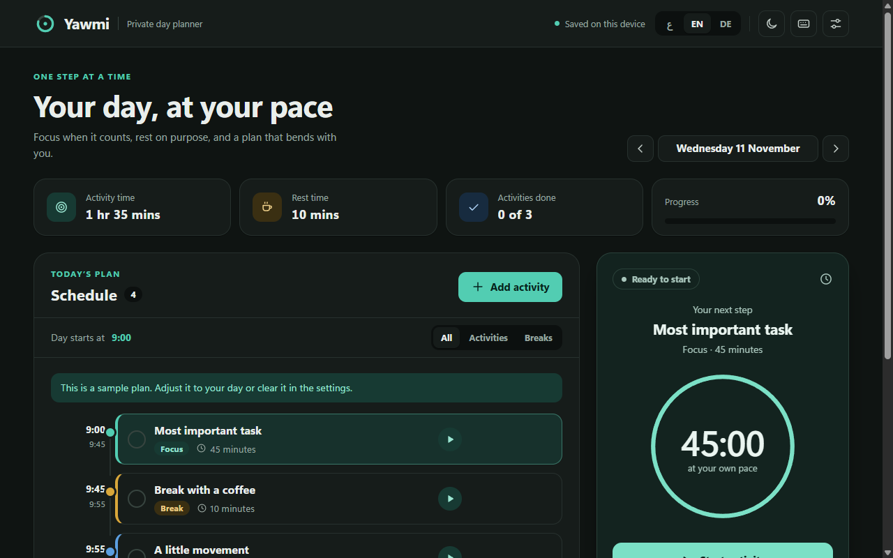
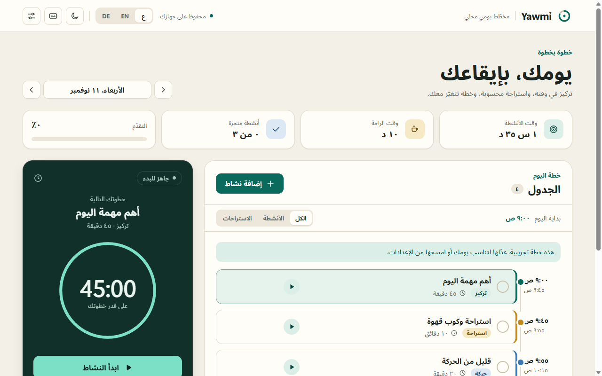
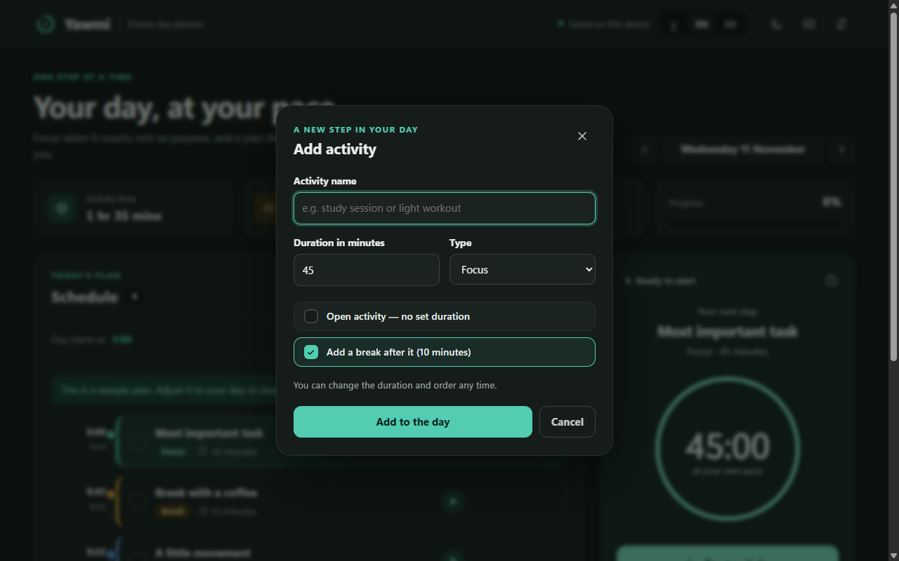
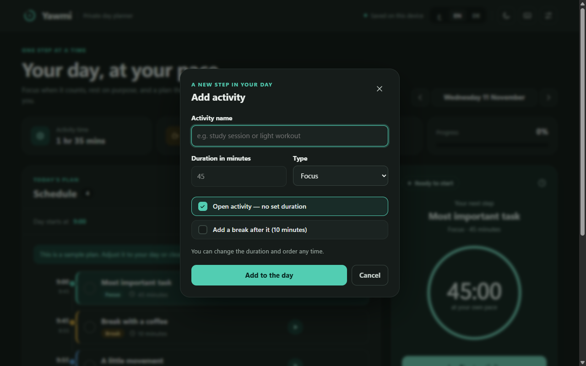
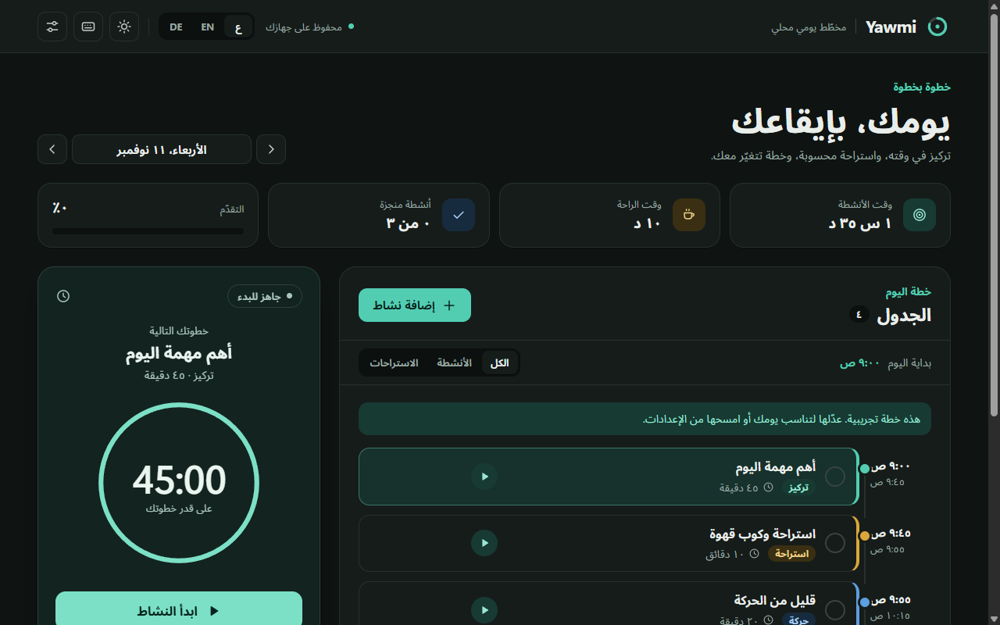

# Yawmi Local — يومي المحلي

<p align="center">
  
</p>

<p align="center">
  <strong>مخطّط يوم يعمل على جهازك فقط — هدوء، خصوصية كاملة، وبدون إنترنت</strong><br>
  <strong>A calm, private day planner that runs only on your PC — 100% offline & local</strong><br>
  <em>Ein privater Tagesplaner, der nur auf deinem PC läuft</em>
</p>

<p align="center">
  
  
  
  
</p>

---

## 📸 نظرة عامة على الواجهة / Interface Preview

### 1. لوحة التحكم الرئيسية (Dark Theme & Arabic RTL)
<p align="center">
  
</p>

<p align="center">
  
</p>

### 2. نافذة إضافة نشاط والتحكم بالوقت (Redesigned Activity Timing & Break Options)
<p align="center">
  
  
</p>

### 3. المظهر الفاتح الدافئ (Paper-Warm Daylight Theme)
<p align="center">
  
</p>

---

## ✨ المميزات الرئيسية / Key Features

### باللغة العربية:
- 🔒 **خصوصية مطلقة (Offline 100%):** لا سيرفر، لا حسابات، لا تتبع، ولا أي اتصال بالإنترنت. تُحفظ بياناتك محلياً ومشفرة في `%APPDATA%\YawmiLocal`.
- ⚡ **نسخة محمولة (Portable Exe):** تعمل فوراً بنقرة واحدة بدون تثبيت وبدون الحاجة لـ Node.js أو أي برامج مسبقة.
- 🎯 **جدول ذكي لكل يوم:** أنشطة (تركيز · شخصي · حركة) واستراحات، مع إعادة الترتيب وتحديث مواعيد اليوم تلقائياً.
- ⏱️ **أنشطة محددة أو مفتوحة:** دعم الأنشطة بالدقائق أو الأنشطة المفتوحة (يُحسب وقتها الفعلي ثانية بثانية).
- 🔔 **منبّه صوتي مستمر:** عند انتهاء الوقت يصدح منبه صوتي محلي هادئ ويستمر حتى تضغط «إيقاف المنبه»، ويعمل أثناء تصغير النافذة مع إشعارات Windows.
- 🌍 **ثلاث لغات أصلية:** العربية بـ RTL كامل مع خط Noto Sans Arabic المدمج، والإنجليزية، والألمانية.
- 💾 **نسخ احتياطي واستيراد:** بصيغة JSON متوافقة، تتيح نقل خطتك بسهولة أو استيراد خططك القديمة.

### In English:
- 🔒 **100% Offline & Private:** Zero network requests, zero tracking, no accounts. All data is kept locally inside `%APPDATA%\YawmiLocal`.
- ⚡ **Single Portable Executable:** Download and launch instantly without installation, administrative privileges, or Node.js runtime.
- 🎯 **Smart Day Timeline:** Reorder activities and breaks with drag or arrows; subsequent timestamps update automatically.
- ⏱️ **Fixed & Open-Ended Activities:** Track fixed-duration sessions or open-ended flow time measured live by the second.
- 🔔 **Persistent Audible Alarm:** Loops until explicitly dismissed, recovering gracefully from minimized state or PC sleep.
- 🌍 **Native Trilingual Support:** Arabic (full RTL layout + Noto Sans Arabic typography), English, and German.
- 💾 **JSON Backup & Restore:** Import and export your daily timeline and history at any time.

---

## ⌨️ اختصارات لوحة المفاتيح / Keyboard Shortcuts

| الوظيفة / Action | الاختصار / Shortcut |
| :--- | :---: |
| نشاط جديد / Add activity | `Ctrl + N` |
| تشغيل / إيقاف المؤقّت / Start or Pause timer | `Ctrl + Space` |
| اليوم الحالي / Go to Today | `Ctrl + T` |
| إعدادات اليوم والمنبه / Day settings | `Ctrl + ,` |
| استيراد خطة / Import backup | `Ctrl + O` |
| تصدير خطة / Export backup | `Ctrl + Shift + S` |
| إغلاق البرنامج / Quit | `Alt + F4` |

---

## 🚀 التشغيل والبناء من المصدر / Build from Source

```powershell
# 1. تثبيت الاعتماديات
npm install --prefix app --ignore-scripts
node app/node_modules/electron/install.js

# 2. تشغيل الفحوصات والاختبارات
npm run check --prefix app
npm test --prefix app

# 3. تشغيل تجريبي مباشر
npm start --prefix app

# 4. بناء النسخة المحمولة والمثبت لـ Windows x64
npm run build:win --prefix app
```

الملفات الناتجة ستجدها في مجلد `app/release/`:
- `YawmiLocal-Portable-3.0.0-x64.exe` (النسخة المحمولة المباشرة)
- `YawmiLocal-Setup-3.0.0-x64.exe` (مثبت رسمي للويندوز)

---

## 🌐 صفحة التوثيق والمعاينة التفاعلية / Interactive Showcase

تتوفر صفحة توثيق تفاعلية بتصميم ويب عصري، تضم مستعرض السكرين شوتس وتبديل المظهر واللغات داخل مجلد:
- **`docs/index.html`** *(افتحها في أي متصفح مباشرة)*

---

## 📄 الترخيص / License

- التطبيق والواجهة: مخصص ومفتوح المصدر للاستخدام الشخصي والإنتاجي.
- الخط العربي المدمج: Noto Sans Arabic تحت ترخيص SIL Open Font License (OFL).
- الحزمة تعتمد على Electron وChromium بموجب تراخيص المصدر المفتوح الخاصة بهما.
